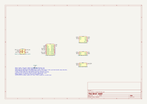

# Bench reader build guide (ESP32-C3)

The bench reader is a small box by the printer. Tap a spool's NFC tag, pick the printer and slot with a knob, and
the filament-kit server links that spool to the slot. It has a PN532 NFC module, a 128x64 OLED, a rotary encoder
with a push switch and a buzzer, on an ESP32-C3 Super Mini. It reaches the server over Wi-Fi and HTTPS, and takes
signed firmware updates over the air.

The reader's server API, firmware build and update steps are in the kit's
[reader/README.md](https://github.com/thompsonfabco/filament-kit/blob/main/reader/README.md). This guide covers the
parts, wiring, case, first flash and bench checks. The checked data for this device is in
[catalogue.xml](catalogue.xml), and the circuit is the KiCad schematic in [kicad/](kicad/), exported as
[images/schematic.svg](images/schematic.svg) and [images/schematic.pdf](images/schematic.pdf).

## Parts

| Ref | Part | Qty | Use |
|---|---|---|---|
| U1 | ESP32-C3 Super Mini | 1 | Controller, powered from USB |
| U2 | PN532 NFC module, set to I2C mode (address 0x24) | 1 | Tag reader |
| U3 | SSD1306 OLED module, 128x64, I2C address 0x3C | 1 | Display |
| SW1 | Rotary encoder with push switch, KY-040 style (see "Encoder") | 1 | Slot and printer knob |
| BZ1 | 3-pin buzzer module, low-level trigger (active-low) | 1 | Beeps and speech |

The datasheet limits for each active part, with their sources, are in [catalogue.xml](catalogue.xml) and in the
schematic's symbol properties.

## Pins

| Function | C3 GPIO | Constant |
|---|---|---|
| I2C SDA (PN532, OLED) | 5 | `PIN_SDA` |
| I2C SCL (PN532, OLED) | 6 | `PIN_SCL` |
| Encoder CLK (A) | 3 | `PIN_ENC_CLK` |
| Encoder DT (B) | 4 | `PIN_ENC_DT` |
| Encoder push switch, other side to 3V3 | 1 | `PIN_ENC_SW` |
| Buzzer signal | 0 | `PIN_BUZZER` |

The PN532's IRQ and RSTO pins stay unconnected. The firmware polls the PN532 over I2C and never uses IRQ. The
header's RSTO is the chip's reset output, not its reset input. Wiring these pins jammed the bus on an earlier
build, with SCL held low. The firmware still names GPIO 7 and 10 for them (`PN532_IRQ`, `PN532_RESET`), but
nothing is wired to those pins.

Never use GPIO 2, 8 or 9, which are strapping pins, or GPIO 18 and 19, which are the USB pair. The pins and
polarities are in the CONFIG block at the top of the firmware's `src/main.cpp`.

## Wiring

All modules run from the C3's 3V3 pin, and every GND goes to the C3's G. The C3 itself is powered from its USB-C
socket.

- **PN532 (U2):** GND to G, VCC to 3V3, SDA to GPIO 5, SCL to GPIO 6. Leave IRQ and RSTO unconnected.
- **OLED (U3):** GND to G, VCC to 3V3, SDA to GPIO 5, SCL to GPIO 6. It shares the bus with the PN532 at a
  different address.
- **Encoder (SW1):** A (CLK) to GPIO 3, B (DT) to GPIO 4, common (C) to G. The push switch goes between GPIO 1
  and 3V3.
- **Buzzer (BZ1):** VCC to 3V3, GND to G, S to GPIO 0.

The I2C bus needs pull-ups. Common PN532 and OLED modules have their own, which is enough (UNCONFIRMED for these
modules). At boot the firmware prints the idle levels of SDA and SCL to the USB serial port (`I2C idle: ...`). Both
must read 1 in the "no pull" pair. It then lists every I2C address that answers: 0x24 is the PN532 and 0x3C the
OLED.

The reader is wired module to module, with no main board. The standard's JST-XH connector rule applies when the
reader is next rebuilt; nothing is rewired for it alone.

### PN532 I2C mode

The PN532 picks its host interface from two pins, I0 and I1. For I2C the chip needs I0 low and I1 high (NXP
PN532/C1 data sheet, Table 72). Modules bring these out as two small switches or jumpers, with a table on the
silkscreen. Set them to the silkscreen's I2C setting, with the power off.

Which switch carries I0 and which I1 differs between module makers, so the switch positions for this build are
UNCONFIRMED. Follow the module's own silkscreen, not a table from another board. A module left in HSU (UART) mode
gives no answer at 0x24, and the serial log at boot says `PN532 not found`.

### Encoder

The firmware reads the encoder this way:

- A and B use the C3's internal pull-ups, so the encoder's common goes to G.
- The push switch uses the C3's internal pull-down, so the switch goes between GPIO 1 and 3V3, and pressed reads
  high (`ENC_SW_TO_VCC = true`).

A stock KY-040 module joins its switch to its own GND pin, which is also the encoder's common. Wired as it comes,
its switch pulls GPIO 1 to G, which the pull-down already holds low, so a press is never seen. Use an encoder whose
switch legs are separate from the common, as the schematic shows, or rewire the module's switch to 3V3. The
encoder actually fitted to this build is UNCONFIRMED.

If turning the knob moves the wrong way, swap the CLK and DT wires.

### Buzzer

The module is marked low-level trigger: a transistor switches it, so S low means on. The firmware holds GPIO 0
high when silent (`buzzIdle()`), and plays beeps and its speech as PWM on the same pin. Use 3V3, not 5 V: a 3.3 V
signal can't turn off a module whose input is pulled up to 5 V.

### Module pin orders

Wire each module from its own silkscreen, not from this table. Pins are listed left to right, except U1, whose two
rows run top to bottom with the USB connector at the top.

| Module | Pin order | Notes |
|---|---|---|
| U1 ESP32-C3 Super Mini | Right row: 5V GND 3V3 GPIO4 GPIO3 GPIO2 GPIO1 GPIO0. Left row: GPIO5 GPIO6 GPIO7 GPIO8 GPIO9 GPIO10 GPIO20 GPIO21 | Top view, from the board |
| U2 PN532 | GND VCC SDA SCL on the I2C header; IRQ and RSTO on the side header | UNCONFIRMED: a common module's order, not photographed |
| U3 OLED | GND VCC SCL SDA | The panel's module order; this module UNCONFIRMED |
| SW1 encoder | KY-040 style: CLK DT SW + GND | UNCONFIRMED: a common module's order, not photographed; see "Encoder" |
| BZ1 buzzer | VCC S GND | The panel's module order; this module UNCONFIRMED |

## Power

Power comes from the USB 5 V into the C3. The C3's 3V3 regulator feeds every module. The PN532 is the largest
load: its data sheet gives at most 150 mA in continuous wave, and below 100 mA with a tuned antenna. The Super
Mini's 3V3 regulator rating is not in the sources found (UNCONFIRMED), so the bench checklist measures the USB
current and the 3V3 rail during a tag read.

## Case

The case is four STEP files in `enclosures/bench-reader/`: `reader_tray.step`, `reader_lid.step`,
`reader_shelf_plate.step` and `reader_assembly.step`. They come from an older project, and their fit against this
build is unchecked. Check that the C3's USB-C plug, the OLED window, the encoder shaft and the PN532 antenna area
line up before printing, and record the result in the bench results.

## First build and flash

The firmware needs the Wi-Fi details, the server's base URL, the reader token and the update public key compiled
in. The kit's
[reader/README.md](https://github.com/thompsonfabco/filament-kit/blob/main/reader/README.md) gives the steps:

1. Create `src/secrets.h` from `src/secrets.example.h` and fill it in. Never commit it.
2. Create the update signing key once, and put its public key in `secrets.h`.
3. Build and flash over USB once: `pio run -e esp32-c3-supermini -t upload`.

After that, updates go over Wi-Fi: publish a signed build, then hold the knob 4 s on the reader.

## Bench checklist

- [ ] The PN532's mode switches are at the I2C setting on its silkscreen. The serial log at boot shows SDA and SCL
  idle at 1 with no pull, and `PN532 found`.
- [ ] The OLED shows the printer name, the slot label and the slot's contents.
- [ ] **Tap:** a known tag sends to the shown slot. The screen, beeps and speech show the result (`set`: two short
  beeps and "set" with the slot).
- [ ] **Turn:** each detent moves one slot, in the expected direction, and the reader says the slot after a moment.
- [ ] **Press:** sends the last tag again to the shown slot.
- [ ] **Hold 1 s:** a tick sounds, and letting go opens the printer list. Turn and press to pick a printer.
- [ ] **Hold 4 s:** the reader checks for an update and installs a newer signed build, then restarts and keeps it.
- [ ] The buzzer is silent when idle, including during reset and boot.
- [ ] USB current during a tag read is measured, and the 3V3 rail holds.
- [ ] The build fits the case, with the USB-C plug, the OLED, the knob and the PN532 in place.

Record the result below, and the firmware build, date and measured current in `catalogue.xml` (`validated` and
`power`).

## Bench results

| Date | Firmware | Result | Measured mA | Notes |
|---|---|---|---|---|
| | | | | |

## To confirm

Values marked UNCONFIRMED in this guide, the catalogue or the schematic, and the photos that would settle them:

- **PN532 module pin order** (I2C header and the IRQ and RSTO pins): a photo of the module's pin labels, both sides.
- **PN532 mode switch positions for I2C:** a photo of the switches and the silkscreen table.
- **PN532 supply:** which pin VCC feeds on this module (VBAT direct or through a regulator), from a photo of the
  module's back.
- **Encoder type and pin order:** a photo of the encoder or module and its wiring, to show whether the push switch
  goes to 3V3 or to G.
- **OLED and buzzer pin orders on this build:** a photo of each module's labels.
- **ESP32-C3 limits:** the per-pin GPIO current limit, the Super Mini's 3V3 regulator rating and its 5 V pin path.
- **SSD1306 and buzzer module current:** no datasheet limit; the OLED's 10 to 20 mA is an estimate.
- **Case fit** against this build.

## ERC notes

`kicad-cli sch erc` reports 0 errors and 0 warnings.
