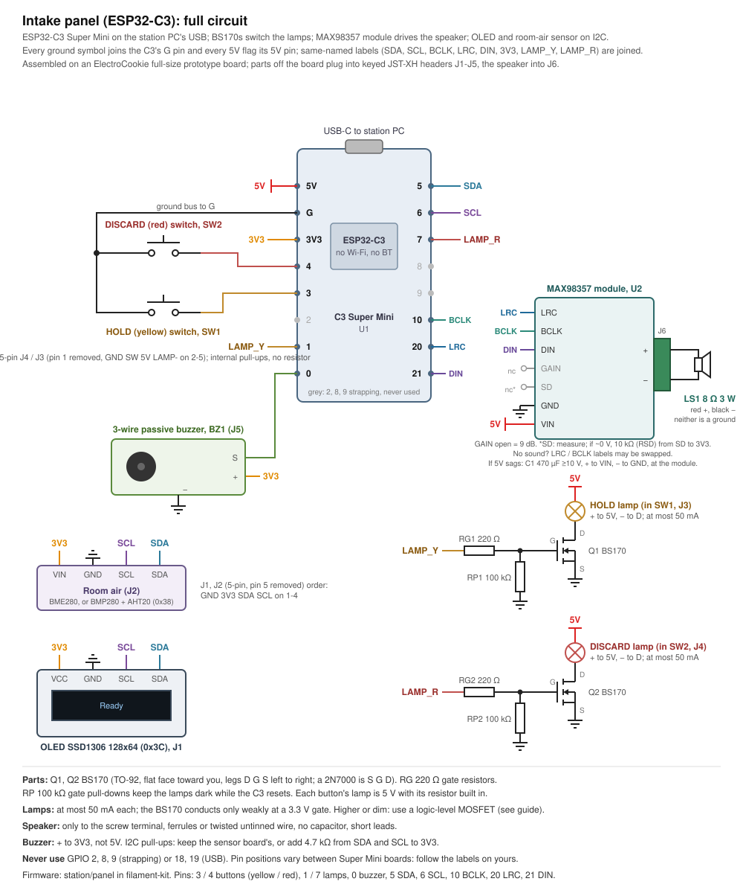

# Intake panel build guide (ESP32-C3)

The intake panel is the intake station's front panel. It has a yellow (Hold) and a red (Discard) illuminated button,
a 128x64 OLED, a buzzer, a speaker on a MAX98357 amplifier, a room-air sensor and an optional PN532 tag reader. It is built on an ESP32-C3 Super
Mini and plugs into the station PC's USB. This guide covers firmware 11 and later.

The panel's behaviour, its serial protocol, the speech format and the firmware update notes are in the kit's
[station/PANEL.md](https://github.com/thompsonfabco/filament-kit/blob/main/station/PANEL.md). This guide covers the parts, wiring, assembly, first flash and bench checks. The checked data
for this device is in [catalogue.xml](catalogue.xml), and the parts to buy, with Amazon listing links, are in
[bom.md](bom.md). The full circuit is the KiCad schematic in [kicad/](kicad/),
exported as [images/schematic.svg](images/schematic.svg) and [images/schematic.pdf](images/schematic.pdf).
[images/wiring.svg](images/wiring.svg) is an overview drawing, not the full circuit: it leaves out the PN532 reader
(U7) and its header (J7).



## Parts

| Ref | Part | Qty | Use |
|---|---|---|---|
| BRD1 | ElectroCookie solderable breadboard prototype board, full size (Amazon ASIN B07ZYNWJ1S) | 1 | Main board |
| U1 | ESP32-C3 Super Mini | 1 | Controller, on the station PC's USB |
| Q1, Q2 | BS170 N-MOSFET (TO-92); a 2N7000 also fits, turned round. The JLCPCB board carries an AO3400A (SOT-23) instead (see "LED MOSFET stages") | 2 | Yellow and red LED switches |
| RG1, RG2 | 220 Ω | 2 | Gate resistors |
| RP1, RP2 | 100 kΩ | 2 | Gate pull-downs, so the LEDs stay dark during reset |
| U2 | AITRIP MAX98357 I2S amplifier module, "No Welding" version (Amazon ASIN B0912CWB7Z, pack of 3) | 1 | Speaker amplifier |
| LS1 | Shutao double-cavity speaker, 8 Ω, 3 W, sealed body about 100 x 45 x 21 mm (Amazon ASIN B0DL9SFH49) | 1 | Speech |
| U3 | SSD1306 OLED module, 128x64, I2C address 0x3C | 1 | Display |
| U4, or U5 + U6 | GY-BME/P280 board with a BMP280 chip (6 pins), or a BMP280 + AHT20 combination board | 1 | Room air |
| U7 | Elechouse NFC Module V3 (PN532), set to I2C mode (address 0x24) | 0 or 1 | Tag reader, optional (see "PN532 reader") |
| BZ1 | 3-pin buzzer module, low-level trigger (active-low) | 1 | Beeps |
| SW1, SW2 | Illuminated normally-open push buttons with built-in 5 V LEDs (series resistor built in), yellow and red | 2 | Hold and Discard |
| RI1, RI2 | 4.7 kΩ | 0 or 2 | I2C pull-ups, only if neither I2C board has them |
| RSD | 10 kΩ | 0 or 1 | Amplifier SD pull-up to 3V3, only if the module has none (see "Amplifier") |
| C1 | 470 µF electrolytic, 10 V or more | 0 or 1 | Across the amplifier's VIN and GND, only if 5 V sags on speech peaks |
| XU1 | Female pin headers, 2.54 mm, 8-pin | 2 | Socket for U1, so its USB-C plug clears the M3 screw head (see "Board and layout") |
| XU2 | Female pin header, 2.54 mm, 7-pin | 0 or 1 | Socket for U2, custom boards only (see "Board") |
| J1-J5 | JST-XH (2.50 mm pitch) headers and plugs: 4-pin x4 (J1-J4) and 3-pin x1 (J5) | 5 | Off-board connectors |
| J7 | JST-XH (2.50 mm pitch) header and plug, 4-pin | 0 or 1 | Off-board connector for U7, only if U7 is fitted |
| F1, F2 | Wire ferrules to suit the speaker wire | 2 | Speaker leads into the screw terminal |

Room-air option B (U5 + U6, the BMP280 + AHT20 board) is optional and not in the [BOM](bom.md), which lists the
BMP280 board (U4).

The datasheet limits for each active part, with their sources, are in [catalogue.xml](catalogue.xml).

## Pins

| Function | C3 GPIO | Constant |
|---|---|---|
| I2C SDA (OLED, air sensor, PN532) | 5 | `PIN_SDA` |
| I2C SCL (OLED, air sensor, PN532) | 6 | `PIN_SCL` |
| Buzzer signal | 0 | `PIN_BUZZER` |
| Yellow (Hold) switch, other side to G | 3 | `PIN_BTN_HOLD` |
| Red (Discard) switch, other side to G | 4 | `PIN_BTN_DISCARD` |
| Yellow LED MOSFET gate | 1 | `PIN_LAMP_HOLD` |
| Red LED MOSFET gate | 7 | `PIN_LAMP_DISCARD` |
| Amplifier BCLK | 10 | `PIN_I2S_BCLK` |
| Amplifier LRC | 20 | `PIN_I2S_LRC` |
| Amplifier DIN | 21 | `PIN_I2S_DIN` |

Never use GPIO 2, 8 or 9, which are strapping pins, or GPIO 18 and 19, which are the USB pair. GPIO 20 and 21 are
the C3's default UART. The firmware doesn't use it, because its serial link is native USB. The ROM's boot text on
GPIO 21 is harmless, because the amplifier stays silent with no I2S clock.

The buttons use the C3's internal pull-ups, so each switch goes between its pin and G with nothing else.

"Lamp" in the firmware's pin and net names (`PIN_LAMP_HOLD`, `LAMP_HOLD`, `HOLD_LAMP-` and the like) means the LED built into each button; the names stay as the firmware has them.

## Connectors

Every part off the main board plugs in through a JST-XH connector (2.50 mm pitch), so the board can come out of its
case without desoldering. The speaker is the one exception: it goes into the amplifier's screw terminal.

| Ref | Type | Pin order | To |
|---|---|---|---|
| J1 | JST-XH 4-pin | GND 3V3 SDA SCL | OLED (U3) |
| J2 | JST-XH 4-pin | GND 3V3 SDA SCL | Air sensor (U4, or U5 and U6) |
| J3 | JST-XH 4-pin | GND SW 5V LED- | Yellow button SW1: SW to GPIO 3, LED- to Q1's drain |
| J4 | JST-XH 4-pin | GND SW 5V LED- | Red button SW2: SW to GPIO 4, LED- to Q2's drain |
| J5 | JST-XH 3-pin | GND 3V3 S | Buzzer BZ1: S to GPIO 0 |
| J6 | Amplifier screw terminal | + - | Speaker LS1 |
| J7 | JST-XH 4-pin | GND 3V3 SDA SCL | PN532 reader U7, optional |

A plug fits any header with the same pin count, and a smaller XH plug can be forced in offset: the buzzer plug in a
button header puts 5 V on the buzzer's 3V3 pin. An OLED or sensor plug in a button header would put 5 V on a 3.3 V
part, and a button plug in an I2C header would short 3V3 to G when the button is pressed. You are responsible for
plugging each harness into the right header:

1. Label each header on the board (I2C, NFC, YELLOW, RED, BUZZER) with a marker or label, next to the header.
2. Find pin 1 on the header: it is the pin at the header's pin-1 mark, and it carries the first signal in the pin order above (GND).
   If the header has no mark, mate a plug before soldering and solder GND to the header pin under the plug's cavity 1.
   Find pin 1 on the plug: the triangle or the cavity number 1 moulded on the housing, which takes the GND wire.
3. Plug each harness into its labelled header with pin 1 to pin 1.

J3 and J4 are the same type, which is safe because both carry the same signals. So are J1, J2 and J7, the three
I2C headers. If the buttons end up swapped, set
`panel_swap` as `PANEL.md` describes instead of rewiring.

## Board

The board comes in two variants with the same outline, holes, connectors and pin-to-pin wiring:

- **Through-hole (DIY)**: `kicad/intake-panel.kicad_pcb`, in the same KiCad project as the schematic. Order the bare
  board and solder the parts yourself.
- **JLCPCB assembly**: `kicad-smt/intake-panel-smt.kicad_pcb`, a second KiCad project whose schematic is a copy of the
  first with surface-mount footprints and an LCSC part number on each board part. JLCPCB makes the board and fits the
  parts (see "Ordering the JLCPCB board").

Without either, the panel is built on the ElectroCookie board as "Board and layout" describes.

Both wire exactly the same pins together; `python tools/netlist_parity.py` with the two schematics checks that. On
the JLCPCB board the resistors are 0603, Q1 and Q2 are AO3400A in SOT-23 (see "LED MOSFET stages") and C1 is a
6.3 mm surface-mount electrolytic. The JST-XH headers and the female headers for U1 and U2 stay through-hole on both,
so the two boards take the same plugs and modules; JLCPCB solders those by hand.

The board is 89 x 52 mm, the outline and hole pattern of the ElectroCookie full board, so it fits cases made for that
board: M3 holes at (7.75, 26) and (81.25, 26), M2 holes at (5.375, 8.25), (83.625, 8.25), (5.375, 43.75) and
(83.625, 43.75), in mm from one corner. It has two layers with a GND pour on both sides, 0.25 mm signal tracks,
0.5 mm 3V3 tracks and 0.8 mm 5V tracks (the amplifier supply and the button LEDs).
Both copper layers stay clear of each mounting hole out to 3.5 mm (M3) and 2.5 mm (M2) from its centre, so a screw
head or a metal standoff can't touch the pour.

| | Through-hole (DIY) | JLCPCB assembly |
|---|---|---|
| Top | [board-tht-top.svg](board/board-tht-top.svg) | [board-smt-top.svg](board/board-smt-top.svg) |
| Bottom (mirrored) | [board-tht-bottom.svg](board/board-tht-bottom.svg) | [board-smt-bottom.svg](board/board-smt-bottom.svg) |
| Both, with the title block | [board-tht.pdf](board/board-tht.pdf) | [board-smt.pdf](board/board-smt.pdf) |
| 3D model | [board-tht.step](board/board-tht.step) | [board-smt.step](board/board-smt.step) |
| Gerbers and drill files | [gerbers-tht.zip](board/gerbers-tht.zip) | [gerbers-smt.zip](board/gerbers-smt.zip) |
| Assembly files | - | [jlcpcb-bom-smt.csv](board/jlcpcb-bom-smt.csv), [jlcpcb-cpl-smt.csv](board/jlcpcb-cpl-smt.csv) |

Each zip holds the Gerbers and the drill files (plated and unplated holes in separate files); the JLCPCB zip also
holds the top paste layer for the stencil. Any board maker that takes Gerbers can make either board: 2 layers, 1.6 mm.

What sits on the board, and why:

- **U1, the C3**, plugs into two 1x8 female headers (XU1) and is never soldered to the board. Its USB-C end sits at
  the top edge, by the "USB-C" mark, so a cable reaches it in a case. The end away from the USB socket carries its
  antenna; the board keeps tracks, vias and the GND pour out from under that end.
- **U2, the amplifier**, plugs into a 1x7 female header (XU2) beside U1, with its pin row facing U1 and its screw
  terminal toward the left short edge. It sits on the board because its I2S lines run straight to U1's pins, it
  draws the panel's largest 5 V current, and the speaker is wired to its own screw terminal, so it needs no harness.
  Its VIN takes 5 V straight from U1's 5V pin over a 22.5 mm, 0.8 mm track along the top edge, on the bottom layer.
  The module covers the spare M2 hole at (5.375, 8.25): fit a screw there, if you use one, before you plug U2 in. The module's outline and the terminal position are UNCONFIRMED; nothing else on the board
  sits under it.
- **C1**, the optional 470 µF capacitor, has its pads below U1, by the "C1" mark, on both boards: there is no room
  for the capacitor beside U2's header. Its + pad reaches U2's VIN over about 45 mm of 0.8 mm track (down the left
  side of U1 and up to VIN), so it steadies the 5 V rail as a whole rather than sitting at the module.
- **Off the board**: the OLED, the air sensor, the buzzer, the two buttons and the PN532 reader mount on the case,
  where each one has to be seen, pressed, heard or reach the room air or the tags, so each one plugs into a JST-XH
  header, as the schematic shows.
- **The LED stages** (Q1, RG1, RP1 and Q2, RG2, RP2) sit above J3 and J4, each drain straight above its header's
  LED- pin.
- **Silkscreen**: the through-hole board reads "filament-kit intake panel THT rev A", the JLCPCB board "filament-kit
  intake panel JLCPCB rev A".

### Connectors

Five headers run along the bottom edge and J5 sits at the top edge. The silkscreen names each header's function and
each pin, and marks pin 1 with a dot.

| Ref | Type | Pin order (pin 1 first) | To |
|---|---|---|---|
| J7 | JST-XH 4-pin | GND 3V3 SDA SCL | PN532 reader U7, optional (header NFC) |
| J1 | JST-XH 4-pin | GND 3V3 SDA SCL | OLED U3 (header OLED) |
| J2 | JST-XH 4-pin | GND 3V3 SDA SCL | Air sensor U4, or U5 and U6 (header AIR) |
| J3 | JST-XH 4-pin | GND SW 5V LED- | Yellow button SW1 (header YELLOW) |
| J4 | JST-XH 4-pin | GND SW 5V LED- | Red button SW2 (header RED) |
| J5 | JST-XH 3-pin | GND 3V3 S | Buzzer BZ1 (header BUZZER) |
| XU2 | Female header, 7-pin | LRC BCLK DIN GAIN SD GND VIN | Amplifier U2, pin 1 (LRC) nearest the bottom edge |

J5 is turned round, so its pin 1 (GND) is its right-hand pin; follow the dot, not the position. The speaker goes
into U2's own screw terminal, not into the board. Make each harness as "Connectors" describes, with the header's pin
order at the plug.

### Parts fitted only when needed

The board has pads for four parts that are left out at first. Each is marked DNP on the silkscreen.

| Ref | Value | Fit it when |
|---|---|---|
| RSD1 (RSD in the parts list) | 10 kΩ | The amplifier's SD reads near 0 V in the SD pull-up check (see "Amplifier") |
| RI1, RI2 | 4.7 kΩ | Neither the OLED nor the air sensor board has I2C pull-ups |
| C1 | 470 µF, 10 V or more | 5 V sags on speech peaks in the bench check. + to the pad by the + mark |

On the JLCPCB board these are 0603 resistors and a 6.3 mm surface-mount electrolytic. JLCPCB leaves them off, as on
the through-hole board; the LCSC part for each is in the [bill of materials](bom.md), to order with the board or to
solder by hand later.

### Ordering the JLCPCB board

1. On jlcpcb.com, upload `board/gerbers-smt.zip` as the board, 2 layers, 1.6 mm; JLCPCB reads the size from the Gerbers.
2. Turn on assembly, top side, and pick the assembly service that fits through-hole parts as well as surface-mount
   ones.
3. Upload `board/jlcpcb-bom-smt.csv` as the BOM and `board/jlcpcb-cpl-smt.csv` as the pick-and-place (CPL) file.
4. Check each part in the placement preview against the silkscreen:
   - Q1 and Q2: the single drain pin points down, toward J3 and J4, and the gate and source pins point up. Correct the
     rotation in the preview if a part shows otherwise.
   - Every JST-XH header has its pin 1 over the silkscreen dot below it. J7, J1, J2, J3 and J4 have pin 1 on the
     left; J5 has its pin 1 on the right (it is turned round). A header turned the wrong way reverses the plug's pin
     order: on J3 and J4 it puts 5 V on the button's switch wire and GND on the LED's - wire, so correct the rotation
     in the preview if a pin 1 sits away from its dot.
   - The rows marked U1A and U1B are the two female headers for U1, which share one footprint on the board; the row
     marked U2 is U2's 1x7 female header.

The positions are each part's centre, or the centre of its pins for the through-hole headers. The BOM lists only
the parts JLCPCB solders: RSD1, RI1, RI2 and C1 stay off (see "Parts fitted only when needed"). U1 and U2 are modules
that plug into their headers and are never soldered. The off-board modules and the harnesses are not part of the
order; buy them from the main parts list. Every part number and its stock are in the [bill of materials](bom.md).

### Assembly order

For the JLCPCB board, the resistors, Q1, Q2 and every header come fitted: start at step 5.

1. Solder the resistors that are always fitted: RG1 and RG2 (220 Ω), RP1 and RP2 (100 kΩ).
2. Solder Q1 and Q2 (BS170), each with its flat face matching its outline on the silkscreen. A 2N7000 has its pins
   mirrored: turn it round against the outline (see "LED MOSFET stages").
3. Solder the two 1x8 female headers for U1. Plug U1 into them while soldering so the rows stay square and 15.24 mm
   apart, then take U1 out. Solder the 1x7 female header for U2 the same way, with U2 plugged in.
4. Solder J1-J5, and J7 if the PN532 reader is fitted, each with its body over its outline on the silkscreen.
5. Before fitting anything else, check with a meter that 3V3, 5V and GND are not shorted to each other (on J5: pin 1
   GND, pin 2 3V3; on J3: pin 3 5V).
6. Plug in U1 with its USB-C socket at the board edge, and U2 with its terminal toward the left edge. Run "First
   flash" and the bench checklist, then fit RSD1, RI1, RI2 or C1 only if a check calls for it.
7. Crimp the harnesses (see "Connectors") and wire the speaker into U2's screw terminal (see "Speaker").

## Board and layout

This section is the build without the custom board, on the ElectroCookie prototype board (see "Board" for the
custom board).

The main board is an ElectroCookie full-size solderable breadboard prototype board. Its strips follow a standard
breadboard: two halves of five-hole strips either side of a centre channel, with power rails along both long edges.
Prove the layout on a solderless breadboard first, then move it across hole for hole.

Measured on a board in hand:

| What | Value |
|---|---|
| Board size | 89 x 52 mm |
| M3 holes | 2, 73.5 mm apart center to center, on the board's long centerline (26 mm in from each long edge) |
| M2 holes | 4, a rectangle 78.25 x 35.5 mm center to center, equally inset from the board edges |

Hole positions, x along the 89 mm length and y across, both from the same corner:

| Hole | x (mm) | y (mm) |
|---|---|---|
| M3 | 7.75 | 26 |
| M3 | 81.25 | 26 |
| M2 | 5.375 | 8.25 |
| M2 | 83.625 | 8.25 |
| M2 | 5.375 | 43.75 |
| M2 | 83.625 | 43.75 |

The case mounts the board on the two M3 holes, with standoffs. The four M2 holes are free for anything else, such
as a cover or a cable clamp. Each M3 hole sits 7.75 mm in from a short edge. Keep parts and wires clear of the area
around each hole you use, where the standoff and screw head go.

Rails: use one long-edge rail pair for 5 V and G and the other for 3V3 and G, and join the two G rails at one end.

**U1 on female headers.** U1 straddles the centre channel, which runs along the board's long centerline, the same
line as the M3 holes. Its USB-C socket faces a short edge, so the plug and cable leave the board over the M3 hole at
that end. U1 can't turn to face a long edge while it straddles the channel, and at the other end it would sit over
the other M3 hole. So mount U1 in two 8-pin female headers soldered to the board, not directly. That lifts the plug
above the M3 screw head and standoff. The bench checklist checks that the cable plugs in fully with the board
screwed into the case.

The amplifier module, U2, sits on the main board with its pins soldered into the strips. It isn't an off-board part,
so it has no JST-XH connector. Only the speaker leaves it, through the screw terminal.

Suggested layout, from the USB end of the board to the far end:

| Region along the length | Half | What sits there |
|---|---|---|
| USB end, past the first mounting hole | Straddling the channel | U1, the C3 Super Mini, in female headers, its USB-C socket toward the board's short edge so the cable can reach it over the hole |
| Next to U1 | One half | U2, the MAX98357 module, its pin row in the strips and its screw terminal toward the board's long edge, so the speaker leads stay short |
| Next to U1 | Other half | J5 (buzzer), then J1 and J2 (I2C) |
| Middle | One half | The yellow LED stage: Q1, RG1 and RP1 |
| Middle | Other half | J3, the yellow button |
| Far end, before the second mounting hole | One half | The red LED stage: Q2, RG2 and RP2 |
| Far end, before the second mounting hole | Other half | J4, the red button |

Each header pin needs its own strip, and no two nets may share a strip. Check this on the breadboard before
soldering, then note the row numbers you used in the bench results.

## Enclosure

The case for the intake station is in `enclosures/intake-station/`. The controller case's speaker grille is
100 x 45 mm, the speaker's size. The simple controller variant has no grille.

## Power

Power comes from the station PC's USB 5 V. The panel's measured total must stay at or under 500 mA, the USB 2.0
limit, which the bench checklist measures. The C3's 5V pin feeds the 5 V rail: the amplifier and the button LEDs. The C3's
3V3 pin feeds the 3V3 rail: the OLED, the air sensor, the buzzer and, if fitted, the PN532. The PN532 is the largest
3V3 load: its short form data sheet (Rev. 1.2, Table 1) gives a continuous total current of 91 mA typical and
140 mA at most. An SSD1306 OLED module draws roughly 10 to 20 mA
from 3V3, an estimate (UNCONFIRMED) because the chip's datasheet gives no module figure. The Super Mini's 3V3 regulator rating and the
path from USB to its 5V pin are not in the sources found (UNCONFIRMED), so the current and rail check on the bench
covers both.

## LED MOSFET stages

Each button has a 5 V LED built in, switched by a BS170 on the low side, because a GPIO pin can't drive it directly.
The button's LED has its own series resistor, so the board adds none: the resistor built into the button is the LED's
series resistor. Each LED draws 10 to 20 mA.

- LED + to 5 V, LED - to the BS170's drain (D), source (S) to G.
- Gate (G) to the LED's GPIO through 220 Ω (RG1, RG2). 100 kΩ (RP1, RP2) from gate to G keeps the LED dark while
  the C3 resets.
- BS170 legs, flat face toward you: D G S, left to right.

**2N7000 alternative.** A 2N7000 (TO-92; Vishay 70226 gives VDS 60 V and ID 200 mA continuous) can take the place of either BS170; 200 mA is ample for a
10 to 20 mA LED. Its pinout is mirrored: flat face toward you, its legs are S G D, left to right. Fit it turned round,
flat face away from you, so its drain and source land where the BS170's did, or swap the drain and source wires. The
gate stays in the middle. Keep the same 220 Ω and 100 kΩ, and run the same two checks below.

**AO3400A on the JLCPCB board.** The JLCPCB board carries an AO3400A (SOT-23, LCSC C20917) in place of each BS170:
the schematic still names the BS170, and only the JLCPCB board's footprint and part number change. Its SOT-23
footprint numbers the pads to the BS170's drain, gate and source, so the wiring is the same. The figures in its LCSC
listing: VDS 30 V, ID 5.7 A continuous, 1.4 W, VGS ±12 V, gate threshold 1.45 V, RDS(on) 48 mΩ at VGS = 2.5 V.
Unlike the BS170, its on-resistance is specified at a gate voltage below the C3's 3.3 V, so it switches an LED fully
on. Run step 1 of the checks below on each LED all the same: the 50 mA limit is the LED's, not the MOSFET's. A 2N7002
(SOT-23, LCSC C8545; listing: VDS 60 V, ID 115 mA continuous, gate threshold 2.5 V, RDS(on) 5 Ω at VGS = 10 V) fits
the same pads and can go in its place in the BOM, but its listing gives no RDS(on) at a 3.3 V gate and 3.3 V is only
just above its 2.5 V threshold, so it is driven no better than the BS170 and needs both checks below.

**Each LED may draw at most 50 mA**, well above its 10 to 20 mA. The C3 drives the gate at only 3.3 V, and the BS170
barely conducts there:

- Its gate threshold is 0.8 V min, 2.1 V typ and 3 V max, so 3.3 V can be only just above it.
- Its datasheet gives no RDS(on) below VGS = 10 V. At 10 V it is 1.2 Ω typ and 5 Ω max.
- Its output curve stops at VGS = 3.0 V, which carries about 0.05 A. Its transfer curve gives roughly 0.1 A or less at
  3.3 V. Both are estimates read from the curves (UNCONFIRMED as figures), not ratings.
- The 500 mA rating is for full gate drive and doesn't apply here.

The MOSFET limits the current itself, so an LED measured through it can read under 50 mA even when it would draw
more. Check each LED in two steps:

1. **Before wiring it to Q1 or Q2,** measure the LED alone: LED + to 5 V, LED - to G, with the meter in series. It
   must draw 50 mA or less; 10 to 20 mA is expected. If it draws more, use a logic-level MOSFET for that LED, as below.
2. **In circuit,** with the LED lit by the station, measure the voltage from the MOSFET's drain to its source. At the
   flow's ready step both LEDs are on. It should be under 0.3 V. A higher reading means the MOSFET isn't fully on, so
   swap it. Use the station to light the LEDs, not a manual `L 1 1` over serial: with no further `L` line, the panel's
   5 s watchdog turns the LEDs off.

If an LED fails either step, replace that BS170 with a logic-level N-MOSFET, for example an AO3400A on a SOT-23 adapter. Pick a part
whose datasheet gives RDS(on) at a gate voltage of 2.5 V or lower. Keep the same 220 Ω and 100 kΩ. Wire it by the
adapter's G, D and S labels, not the BS170's leg order, and add it to the catalogue with its datasheet limits. The
2N7000 is not a fix here: its gate threshold and RDS(on) ratings are about the same as the BS170's.

## Amplifier (MAX98357 module)

- VIN to 5 V, GND to G.
- BCLK to GPIO 10, LRC to GPIO 20, DIN to GPIO 21.
- Leave GAIN unconnected. That gives 9 dB of gain.
- Leave SD unconnected at first, then check it as described below.

The module sits on the main board itself, next to U1 (see "Board and layout"), so it needs no JST-XH connector.

The module's listing has no schematic and is unreliable on electrical figures. A photo of the board shows the
pin labels LRC BCLK DIN GAIN SD GND VIN, and the back silkscreen says "Default 9db Gain & (L+R)/2 out", so the board
has its own SD pull-up. It gives 5.5 V as both the minimum and maximum supply. The chip's datasheet gives 2.5 to 5.5 V
operating and 6 V absolute maximum, and this panel uses 5 V.

**SD pull-up check.** The board's own pull-up is confirmed by its silkscreen; this check confirms it on the bench. With the panel powered and SD unconnected, measure SD to G. The
chip pulls SD down internally through 100 kΩ, and with SD low the amplifier stays shut down and silent. The chip's
SD trip points, min / typ / max:

| SD voltage | Mode |
|---|---|
| Below 0.08 / 0.16 / 0.355 V | Shutdown: no sound |
| Up to 0.65 / 0.77 / 0.825 V | Left and right mixed |
| Up to 1.245 / 1.4 / 1.5 V | Right channel |
| Above that | Left channel |

The firmware writes every sample to both channels, so any mode except shutdown plays correctly. If SD measures near
0 V, the pull-up is not doing its job on this unit, so tie SD to 3V3 through a 10 kΩ resistor (RSD) and measure again. With the chip's
100 kΩ pull-down, 10 kΩ puts SD near 3.0 V, in the left-channel range. Record the voltage you measured in the bench
results.

**LRC and BCLK labels (UNCONFIRMED on this module).** One user report found the LRC and BCLK labels swapped on
another maker's board. If there is no sound and SD is not in shutdown, swap the two wires on GPIO 10 and GPIO 20 at
the module and try again. If the swap fixes it, note it in the bench results.

## Speaker

The speaker goes only into the module's screw terminal. Neither output is a ground, so never connect either speaker
wire to G or to anything else.

1. Cut off the speaker's 2-pin plug.
2. Crimp a ferrule onto each bare wire, or leave the wires twisted and untinned. Don't tin them: solder creeps under
   a screw terminal and the joint loosens.
3. Red to +, black to -. Fit no capacitor.
4. Keep the leads short, because the outputs switch at high speed.

The listing gives both 10 cm and about 6 inches for the wire length (UNCONFIRMED). Measure it before you lay out the
board.

The speaker is rated 3 W. Its listing also says "maximum power 5W" (UNCONFIRMED), and this design uses the 3 W
figure. At 5 V into 8 Ω the amplifier can put out about 3.1 W in the worst case, a full-scale square wave, and about
1.6 W for a full-scale sine, so the speaker needs no protection from the volume setting. Current is the tighter
limit: 8 Ω at 5 V can peak at about 625 mA, which the bench check measures against the USB limit. The station's
default volume of 50 keeps peak speaker current near 310 mA.

## OLED, air sensor and buzzer

- **OLED (SSD1306 128x64, 0x3C) and air sensor:** both on the I2C bus through J1 and J2, VCC to 3V3 and GND to G,
  SDA to GPIO 5 and SCL to GPIO 6. The bus needs pull-ups: keep the sensor board's, or add 4.7 kΩ from SDA and SCL
  to 3V3 (RI1, RI2) if neither board has them. The air sensor is a GY-BME/P280 board with a BMP280
  chip, or a BMP280 + AHT20 combination board, in which the AHT20 answers at 0x38. The BMP280 board gives temperature
  and pressure only, so humidity reads "-"; use the combination board for humidity. Leave the BMP280 board's CSB
  and SDO pins unconnected: its own pull-ups put CSB high (I2C) and set the address to 0x76 or 0x77, and the firmware
  tries both.
- **Buzzer:** VCC to 3V3, GND to G, I/O to GPIO 0. The module is marked low-level trigger: a transistor switches
  it, so I/O low means on. The panel firmware holds GPIO 0 high when silent. Use 3V3, not 5 V: a 3.3 V signal can't
  turn off a module whose input is pulled up to 5 V.

## PN532 reader (optional)

U7 is the same PN532 module as the bench reader's, an Elechouse NFC Module V3 in I2C mode at address 0x24. It is
optional: build the panel without it, and the station's USB reader ([station-nfc](../station-nfc/guide.md)) reads
tags instead. Both readers may be connected at the same time; the station counts the same tag from either reader
within 2 s as one tap.

- **Wiring (J7):** GND to G, VCC to 3V3, SDA to GPIO 5, SCL to GPIO 6. Leave IRQ and RSTO unconnected. J7's pin
  order, GND 3V3 SDA SCL, is the module's own 4-pin header order.
- **Bus:** U7 shares the I2C bus with the OLED (0x3C) and the air sensor (0x76 or 0x77, and 0x38 for the AHT20).
- **Panel lines:** firmware 11 and later sends `NFC ok` or `NFC none` after every `HELLO` and whenever the state
  changes (detection is retried every 5 s), and `TAG <uid hex>`, in lowercase hex, once per tag presentation. The full protocol is in `PANEL.md`.

### PN532 I2C mode

The PN532 picks its host interface from two pins, I0 and I1. For I2C the chip needs I0 high and I1 low (NXP
PN532 User Manual, Table 7). Modules bring these out as two small switches or jumpers, with a table on the
silkscreen. Set them to the silkscreen's I2C setting, with the power off.

On the Elechouse NFC Module V3 the two-position switch is labelled 1 and 2, with a silkscreen table for HSU, I2C and
SPI. Switch 1 is I0 (its row reads HSU 0, I2C 1, SPI 0). For I2C set switch 1 ON and switch 2 OFF; for HSU set both
OFF. Switch 2 is I1, so its OFF setting for I2C follows Table 7 (I2C needs I1 low).
Follow the module's own silkscreen, not a table from another board. A module left in HSU (UART) mode gives no answer
at 0x24, and the panel reports `NFC none`.

### Module pin orders

Wire each harness from the module's silkscreen, not from the header order above. Pins are listed left to right, except U1, whose two rows run top to bottom with the USB connector at the top.

| Module | Pin order | Notes |
|---|---|---|
| U1 ESP32-C3 Super Mini | Both rows run top to bottom, USB at the top. Right row: 5V GND 3V3 GPIO4 GPIO3 GPIO2 GPIO1 GPIO0. Left row: GPIO5 GPIO6 GPIO7 GPIO8 GPIO9 GPIO10 GPIO20 GPIO21 | Top view |
| U2 MAX98357A module | LRC BCLK DIN GAIN SD GND VIN | Screw terminal on the opposite edge: - on the left, + on the right. The board's own SD pull-up gives (L+R)/2 output |
| U3 OLED | GND VCC SCL SDA | |
| U4 GY-BME/P280 (BMP280) | VCC GND SCL SDA CSB SDO | CSB and SDO use the module's pull-ups |
| BZ1 buzzer | VCC I/O GND | Low-level trigger |
| U7 PN532 | GND VCC SDA SCL on the 4-pin header, component side; the back labels the same holes GND VCC TXD RXD. Side header: SCK MISO MOSI SS VCC GND IRQ RSTO | Confirmed from the board; IRQ and RSTO stay unconnected |

## First flash

A new C3 has no firmware, so it can't answer `HELLO`. Unplug any other ESP32-C3 device, such as a bench reader
plugged in for power, then plug the panel into the station PC and run:

```
sudo filament-kit station flash-panel
```

It stops the station service and lists the C3 ports that give no `HELLO`. It names each port and asks before
flashing it, then checks for `HELLO` and restarts the service. A board that already answers is left alone. After
that, the station keeps the panel's firmware current by itself.

## Bench checklist

Build checks, before the panel goes into service:

- [ ] SD on the amplifier measured with nothing connected, and tied to 3V3 through 10 kΩ (RSD) if it sat near 0 V.
- [ ] Each LED measured alone, before wiring it to its MOSFET, from 5 V to G with the meter in series: 50 mA or
  less (10 to 20 mA expected). If more, use a logic-level MOSFET for it (see "LED MOSFET stages").
- [ ] With both LEDs lit by the station (the flow's ready step), drain to source on Q1 and on Q2 is under 0.3 V, and
  both LEDs are fully bright. If higher, swap that MOSFET for a logic-level one.
- [ ] With the board screwed into the case, the USB-C cable plugs into U1 fully without touching the M3 screw or
  standoff.
- [ ] Each harness is in its labelled header, pin 1 to pin 1.
- [ ] If U7 is fitted, its mode switches are at the I2C setting on its silkscreen (switch 1 ON, switch 2 OFF), set
  with the power off.

Panel checklist:

- [ ] A cold boot gives `HELLO intake-panel 11 esp32c3`, with both LEDs dark during reset.
- [ ] The station finds the panel. With U7 fitted, the panel reports `NFC ok` after `HELLO`; without it, `NFC none`.
- [ ] With U7 fitted, a tag tapped at the panel reader starts one intake.
- [ ] If the USB reader is also connected, it opens as the station's reader, and the same tag tapped at both
  readers within 2 s starts one intake.
- [ ] Unplugging and replugging the panel recovers without a service restart.
- [ ] The station updates the panel from an older C3 firmware by itself.
- [ ] Each button gives a short and a long press, and each LED shows all modes.
- [ ] The OLED shows all rows, and "Station offline" 5 s after the service stops.
- [ ] Air readings appear in `/state` for the fitted sensor.
- [ ] Beeps play at the flow's frequencies, and a beep during speech leaves the speech intact.
- [ ] Speech is clear at the chosen volume and filter, with no whine and no buzzing or rattle from the speaker.
- [ ] Power-up, reset, phrase start, phrase end and a phrase cut off by a newer one make no thump.
- [ ] Idle hiss between phrases is not noticeable at working distance.
- [ ] A full intake runs from scan to save with a real spool.
- [ ] USB current with both LEDs lit and speech at the chosen volume is at or under 500 mA, and the 5 V and 3V3 rails
  hold. If 5 V sags on speech peaks, fit C1, a 470 µF electrolytic rated 10 V or more: on the prototype board at the
  module, + to VIN and - to GND; on a custom board in its C1 pads (see "Board"). Then measure again.

Record the result below, and the firmware version, date and measured current in `catalogue.xml` (`validated` and
`power`).

## Bench results

| Date | Firmware | Result | Measured mA | Notes |
|---|---|---|---|---|
| | | | | |
