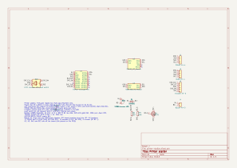

# Printer station build guide (ESP32-C3)

The printer station is a small box by the printer. Tap a spool's NFC tag, pick the printer and slot with a knob, and
the filament-kit server links that spool to the slot. It has a PN532 NFC module, a 128x64 OLED, a rotary encoder
with a push switch and a buzzer, on an ESP32-C3 Super Mini. It reaches the server over Wi-Fi and HTTPS, and takes
signed firmware updates over the air.

The reader's server API, firmware build and update steps are in the kit's
[reader/README.md](https://github.com/thompsonfabco/filament-kit/blob/main/reader/README.md). This guide covers the
parts, wiring, case, first flash and bench checks. The checked data for this device is in
[catalogue.xml](catalogue.xml), the parts to buy, with Amazon listing links, are in [bom.md](bom.md), and the
circuit is the KiCad schematic in [kicad/](kicad/), exported as
[images/schematic.svg](images/schematic.svg) and [images/schematic.pdf](images/schematic.pdf). The reader can be built
on its own through-hole board (see "Board") or wired module to module (see "Wiring").

## Parts

| Ref | Part | Qty | Use |
|---|---|---|---|
| U1 | ESP32-C3 Super Mini | 1 | Controller, powered from USB |
| U2 | Elechouse NFC Module V3 (PN532), set to I2C mode (address 0x24) | 1 | Tag reader |
| U3 | SSD1306 OLED module, 128x64, I2C address 0x3C | 1 | Display |
| SW1 | EC11 rotary encoder with push switch, 5 pins, switch legs separate from the common (see "Encoder") | 1 | Slot and printer knob |
| BZ1 | 12085 magnetic passive buzzer, 12 x 8.5 mm, 42 Ω coil, 2 leads | 1 | Beeps |
| Q1 | BS170 N-MOSFET (TO-92) | 1 | Buzzer switch, on the low side (see "Buzzer driver") |
| RG1 | 220 Ω resistor, 1/4 W | 1 | Q1 gate resistor |
| RP1 | 100 kΩ resistor, 1/4 W | 1 | Q1 gate pull-down: the buzzer stays silent while the C3 resets |
| D1 | 1N4001 diode (DO-41) | 1 | Flyback diode across the buzzer coil |
| J1-J4 | JST-XH (2.50 mm pitch) headers and plugs: 4-pin x2 (J1, J2), 5-pin x1 (J3), 2-pin x1 (J4) | 4 | Off-board connectors, board build only |
| U1 socket | Female pin headers, 2.54 mm, 8-pin | 2 | Socket for U1 on the board, board build only |
| PCB | Printer station through-hole board, 89 x 52 mm, 2 layers | 1 | Board build only |

The datasheet limits for each active part, with their sources, are in [catalogue.xml](catalogue.xml) and in the
schematic's symbol properties.

## Pins

| Function | C3 GPIO | Constant |
|---|---|---|
| I2C SDA (PN532, OLED) | 5 | `PIN_SDA` |
| I2C SCL (PN532, OLED) | 6 | `PIN_SCL` |
| Encoder CLK (A) | 3 | `PIN_ENC_CLK` |
| Encoder DT (B) | 4 | `PIN_ENC_DT` |
| Encoder push switch, other side to 3V3 | 1 | `PIN_ENC_SW` |
| Buzzer driver (Q1's gate, through RG1); high = on | 0 | `PIN_BUZZER` |

The PN532's IRQ and RSTO pins stay unconnected. The firmware polls the PN532 over I2C and never uses IRQ. The
header's RSTO is the chip's reset output, not its reset input. Wiring these pins jammed the bus on an earlier
build, with SCL held low. The firmware still names GPIO 7 and 10 for them (`PN532_IRQ`, `PN532_RESET`), but
nothing is wired to those pins.

Never use GPIO 2, 8 or 9, which are strapping pins, or GPIO 18 and 19, which are the USB pair. The pins and
polarities are in the CONFIG block at the top of the firmware's `src/main.cpp`.

## Wiring

All modules run from the C3's 3V3 pin, and every GND goes to the C3's G. The buzzer is the exception: it runs from
the C3's 5V pin through its driver stage. The C3 itself is powered from its USB-C socket.

- **PN532 (U2):** GND to G, VCC to 3V3, SDA to GPIO 5, SCL to GPIO 6. Leave IRQ and RSTO unconnected.
- **OLED (U3):** GND to G, VCC to 3V3, SDA to GPIO 5, SCL to GPIO 6. It shares the bus with the PN532 at a
  different address.
- **Encoder (SW1):** A (CLK) to GPIO 3, B (DT) to GPIO 4, common (C) to G. The push switch goes between GPIO 1
  and 3V3.
- **Buzzer (BZ1):** + to the C3's 5V pin, - to Q1's drain. Q1's source to G, its gate to GPIO 0 through RG1
  (220 Ω), and RP1 (100 kΩ) from the gate to G. D1 across the buzzer: cathode (banded end) to 5V, anode to Q1's
  drain. See "Buzzer driver".

The I2C bus needs pull-ups. Common PN532 and OLED modules have their own, which is enough (UNCONFIRMED for these
modules). At boot the firmware prints the idle levels of SDA and SCL to the USB serial port (`I2C idle: ...`). Both
must read 1 in the "no pull" pair. It then lists every I2C address that answers: 0x24 is the PN532 and 0x3C the
OLED.

This is the no-board build: each module is wired straight to the C3, and the buzzer's driver (Q1, RG1, RP1, D1) is
built on a scrap of protoboard. The board build (see "Board") carries the driver and makes the same connections
through JST-XH headers.

### PN532 I2C mode

The PN532 picks its host interface from two pins, I0 and I1. For I2C the chip needs I0 high and I1 low (NXP
PN532 User Manual, Table 7). Modules bring these out as two small switches or jumpers, with a table on the
silkscreen. Set them to the silkscreen's I2C setting, with the power off.

On the Elechouse NFC Module V3 the two-position switch is labelled 1 and 2, with a silkscreen table for HSU, I2C and
SPI. Switch 1 is I0 (its row reads HSU 0, I2C 1, SPI 0). For I2C set switch 1 ON and switch 2 OFF; for HSU set both
OFF. Switch 2 is I1, so its OFF setting for I2C follows Table 7 (I2C needs I1 low).
Follow the module's own silkscreen, not a table from another board. A module left in HSU (UART) mode gives no answer
at 0x24, and the serial log at boot says `PN532 not found`.

### Encoder

The firmware reads the encoder this way:

- A and B use the C3's internal pull-ups, so the encoder's common goes to G.
- The push switch uses the C3's internal pull-down, so the switch goes between GPIO 1 and 3V3, and pressed reads
  high (`ENC_SW_TO_VCC = true`).

A stock KY-040 module joins its switch to its own GND pin, which is also the encoder's common. Wired as it comes,
its switch pulls GPIO 1 to G, which the pull-down already holds low, so a press is never seen. The EC11 in the
BOM is a bare encoder whose switch legs are separate from the common, as the schematic shows. If a KY-040 module is
used instead, rewire its switch to 3V3.

If turning the knob moves the wrong way, swap the CLK and DT wires.

### Buzzer driver

The buzzer is a bare magnetic passive buzzer, type 12085 (12 x 8.5 mm, 42 Ω coil; the listing rates it 3 to 12 V).
Its coil draws 5 V / 42 Ω ≈ 119 mA at its peak, well over what a C3 GPIO pin can give, so a BS170 switches it on
the low side, as the intake panel's LED stages do. It is high-triggered: GPIO 0 high turns it on. The firmware holds
GPIO 0 low when silent (`buzzIdle()`, with `BUZZER_ACTIVE_LOW = false` in the CONFIG block) and plays beeps as
square-wave PWM on the same pin.

- Buzzer + to 5V, buzzer - to the BS170's drain (D), source (S) to G.
- Gate (G) to GPIO 0 through 220 Ω (RG1). 100 kΩ (RP1) from gate to G keeps the buzzer silent while the C3 resets.
- D1 (1N4001) across the buzzer: cathode (the banded end) to 5V, anode to the drain. It takes the coil's kick each
  time Q1 turns off.
- BS170 legs, flat face toward you: D G S, left to right.

The C3 drives the gate at only 3.3 V, and the BS170 barely conducts there:

- Its gate threshold is 0.8 V min, 2.1 V typ and 3 V max, so 3.3 V can be only just above it.
- Its datasheet gives no RDS(on) below VGS = 10 V. At 10 V it is 1.2 Ω typ and 5 Ω max.
- Its output curve stops at VGS = 3.0 V, which carries about 0.05 A. Its transfer curve gives roughly 0.1 A or less at
  3.3 V. Both are estimates read from the curves (UNCONFIRMED as figures), not ratings.
- The 500 mA rating is for full gate drive and doesn't apply here.

So the buzzer's 119 mA peak may be more than a BS170 passes at a 3.3 V gate. Check it on the bench: with the buzzer
beeping, it should sound clear and loud. If it is weak, measure the voltage from Q1's drain to its source while a
tone plays; a reading well above 0.3 V means the MOSFET isn't fully on. Then replace the BS170 with a logic-level
N-MOSFET, for example an AO3400A on a SOT-23 adapter. Pick a part whose datasheet gives RDS(on) at a gate voltage
of 2.5 V or lower. Keep the same 220 Ω and 100 kΩ. Wire it by the adapter's G, D and S labels, not the BS170's leg
order, and add it to the catalogue with its datasheet limits. The 2N7000 is not a fix here: its gate threshold and
RDS(on) ratings are about the same as the BS170's.

### Module pin orders

Wire each module from its own silkscreen, not from this table. Pins are listed left to right, except U1, whose two
rows run top to bottom with the USB connector at the top.

| Module | Pin order | Notes |
|---|---|---|
| U1 ESP32-C3 Super Mini | Right row: 5V GND 3V3 GPIO4 GPIO3 GPIO2 GPIO1 GPIO0. Left row: GPIO5 GPIO6 GPIO7 GPIO8 GPIO9 GPIO10 GPIO20 GPIO21 | Top view, from the board |
| U2 PN532 | GND VCC SDA SCL on the 4-pin header, component side; the back labels the same holes GND VCC TXD RXD. Side header: SCK MISO MOSI SS VCC GND IRQ RSTO | Confirmed from the board; IRQ and RSTO stay unconnected |
| U3 OLED | GND VCC SCL SDA | The panel's module order; this module UNCONFIRMED |
| SW1 encoder | EC11: A C B on the three-pin side, switch S1 S2 on the two-pin side | The usual EC11 layout; check the part. C to G, S1 to GPIO 1, S2 to 3V3; see "Encoder" |
| BZ1 buzzer | + and -, two leads | Follow the + mark on the buzzer; + goes to 5V |

## Board

The board is one design, `kicad/printer-station.kicad_pcb`, in the same KiCad project as the schematic. Every part on
it is through-hole: the four JST-XH headers, the two female headers for U1, and the buzzer driver (Q1, RG1, RP1 and
D1). With no surface-mount part to fit,
an assembly order would add nothing, so there is no separate JLCPCB variant: order the board bare, from JLCPCB or any
board maker that takes Gerbers (see "Ordering the board"). The end user fits the buzzer driver, the JST-XH
headers and the U1 sockets (see "Assembly order").

The board is 89 x 52 mm, the outline and hole pattern of the ElectroCookie full board, so it fits cases made for that
board: M3 holes at (7.75, 26) and (81.25, 26), M2 holes at (5.375, 8.25), (83.625, 8.25), (5.375, 43.75) and
(83.625, 43.75), in mm from one corner. It has two layers with a GND pour on both sides, 0.25 mm signal tracks, and
0.5 mm tracks for 3V3, 5V and the buzzer's switched side (BZ-), which carries up to 119 mA. Both copper layers stay
clear of each mounting hole out to 3.5 mm (M3) and 2.5 mm (M2) from its centre, so a screw head or a metal standoff
can't touch the pour.

| View | File |
|---|---|
| Top | [board-tht-top.svg](board/board-tht-top.svg) |
| Bottom (mirrored) | [board-tht-bottom.svg](board/board-tht-bottom.svg) |
| Both, with the title block | [board-tht.pdf](board/board-tht.pdf) |
| 3D model | [board-tht.step](board/board-tht.step) |
| Gerbers and drill files | [gerbers-tht.zip](board/gerbers-tht.zip) |

The zip holds the Gerbers and the drill files (plated and unplated holes in separate files).

U1 plugs into two 1x8 female headers and is never soldered to the board. Its USB-C end sits at the top edge, so a
cable reaches it in a case. The end of U1 away from the USB socket carries its antenna; the board keeps tracks, vias
and the GND pour out from under that end.

### Connectors

Every module plugs in through a JST-XH header along the bottom edge. The silkscreen names each header's function
and each pin above it, and puts its reference and a dot under pin 1 below it.

| Ref | Type | Pin order (pin 1 first) | To |
|---|---|---|---|
| J1 | JST-XH 4-pin | GND 3V3 SDA SCL | PN532 (U2): GND, VCC, SDA, SCL |
| J2 | JST-XH 4-pin | GND 3V3 SDA SCL | OLED (U3): GND, VCC, SDA, SCL |
| J3 | JST-XH 5-pin | A B C SW 3V3 | Encoder (SW1): A, B, C, S1, S2 |
| J4 | JST-XH 2-pin | 5V BZ- | Buzzer (BZ1): +, - |

J1 is turned round on the board, so its pin 1 (GND) is its right-hand pin; follow the silkscreen, not the position.
J1 and J2 carry the same signals, so their plugs are interchangeable. J3 is the only 5-pin header, so the encoder plug
can't go into an I2C header.

Make each harness with the header's pin order at the plug, and wire the other end to the module by name, not by
position: the OLED's own order is GND VCC SCL SDA (see "Module pin orders"). On the buzzer, 5V goes to its + lead
and BZ- to its - lead. On the encoder, A and B go to its A and B pins, C to its common, SW to switch leg S1 and 3V3
to switch leg S2.

### Ordering the board

1. On jlcpcb.com, or at any board maker that takes Gerbers, upload `board/gerbers-tht.zip`: 2 layers, 1.6 mm. The
   maker reads the size from the Gerbers.
2. Leave assembly off: the end user fits every part on this board.
3. Buy the driver parts, the headers and the harness parts from the [bill of materials](bom.md). The same
   headers are in JLCPCB's parts library, with the LCSC part numbers listed there, if you would rather order them with
   the board as loose parts.

### Assembly order

1. Solder the two 1x8 female headers. Plug U1 into them while soldering so the rows stay square and 15.24 mm apart,
   then take U1 out.
2. Solder RG1 (220 Ω) and RP1 (100 kΩ), then D1 with its band at the end marked K, then Q1 (BS170) with its flat
   face matching its outline on the silkscreen.
3. Solder J1-J4, each with its body over its outline on the silkscreen.
4. Before fitting anything, check with a meter that 3V3 and GND are not shorted (J1 pins 2 and 1), and that 5V and
   GND are not shorted (J4 pin 1 to J1 pin 1).
5. Crimp the four harnesses (see "Connectors").
6. Plug U1 in with its USB-C socket at the board edge, by the "USB-C" mark.
7. Plug in each harness, pin 1 to pin 1, then work through the bench checklist.

## Power

Power comes from the USB 5 V into the C3. The C3's 3V3 regulator feeds every module except the buzzer, which
runs from the C3's 5V pin and draws up to 119 mA while it sounds. The PN532 is the largest load on 3V3: its short
form data sheet (Rev. 1.2, Table 1) gives a continuous total current of 91 mA typical and 140 mA at most. The Super
Mini's 3V3 regulator rating is not in the sources found (UNCONFIRMED), so the bench checklist measures the USB
current and the 3V3 rail during a tag read.

## Case

The case is the printer scan station, in `enclosures/printer-station/`. The case has three parts:

| Part | File |
|---|---|
| Body | `printer scan station-Body.step` |
| Face | `printer scan station-Face.step` |
| Retainer | `printer scan station-Retainer.step` |
| Print file for all three | `printer scan station.3mf` |

The 3MF is the print file; the STEP files are for editing the design. The models are licensed CC BY-NC-SA 4.0 (see
`enclosures/LICENSE`). Its fit against this build is unchecked. Check that the C3's USB-C plug, the OLED window, the
encoder shaft and the PN532 antenna area line up before printing, and record the result in the bench results.

## First build and flash

The firmware needs the Wi-Fi details, the server's base URL, the reader token and the update public key compiled
in. The kit's
[reader/README.md](https://github.com/thompsonfabco/filament-kit/blob/main/reader/README.md) gives the steps:

1. Create `src/secrets.h` from `src/secrets.example.h` and fill it in. Never commit it.
2. Create the update signing key once, and put its public key in `secrets.h`.
3. Build and flash over USB once: `pio run -e esp32-c3-supermini -t upload`.

After that, updates go over Wi-Fi: publish a signed build, then hold the knob 4 s on the reader.

## Bench checklist

- [ ] The PN532's mode switches are at the I2C setting on its silkscreen (switch 1 ON, switch 2 OFF). The serial log at boot shows SDA and SCL
  idle at 1 with no pull, and `PN532 found`.
- [ ] The OLED shows the printer name, the slot label and the slot's contents.
- [ ] **Tap:** a known tag sends to the shown slot. The screen and the beeps show the result (`set`: two short
  beeps).
- [ ] **Turn:** each detent moves one slot, in the expected direction, on the screen.
- [ ] **Press:** sends the last tag again to the shown slot.
- [ ] **Hold 1 s:** a tick sounds, and letting go opens the printer list. Turn and press to pick a printer.
- [ ] **Hold 4 s:** the reader checks for an update and installs a newer signed build, then restarts and keeps it.
- [ ] The buzzer is silent when idle, including during reset and boot.
- [ ] The beeps are clear and loud. If they are weak, Q1's drain-to-source voltage during a tone is measured, and the
  BS170 swapped for a logic-level MOSFET if it reads well above 0.3 V (see "Buzzer driver").
- [ ] USB current during a tag read is measured, and the 3V3 rail holds.
- [ ] The build fits the case, with the USB-C plug, the OLED, the knob and the PN532 in place.

Record the result below, and the firmware build, date and measured current in `catalogue.xml` (`validated` and
`power`).

## Bench results

| Date | Firmware | Result | Measured mA | Notes |
|---|---|---|---|---|
| | | | | |

## To confirm

Values marked UNCONFIRMED in this guide, the catalogue or the schematic, and the photos that would settle them:

- **PN532 supply:** which pin VCC feeds on this module (VBAT direct or through a regulator), from a photo of the
  module's back.
- **OLED pin order on this build:** a photo of the module's labels.
- **ESP32-C3 limits:** the per-pin GPIO current limit, the Super Mini's 3V3 regulator rating and its 5 V pin path.
- **SSD1306 current:** no datasheet limit; the OLED's 10 to 20 mA is an estimate.
- **Buzzer:** no datasheet; its 3-12 V rating and 42 Ω coil come from the listing.
- **BS170 at a 3.3 V gate:** whether it passes the buzzer's 119 mA peak (see "Buzzer driver").
- **Case fit** against this build.
- **Antenna position** on the Super Mini: the board's keep-out assumes the antenna is at the end away from the
  USB socket.

## ERC notes

`kicad-cli sch erc` reports 0 errors and 0 warnings. `kicad-cli pcb drc --schematic-parity` on the board reports 0
violations, 0 unconnected items and 0 parity issues.
