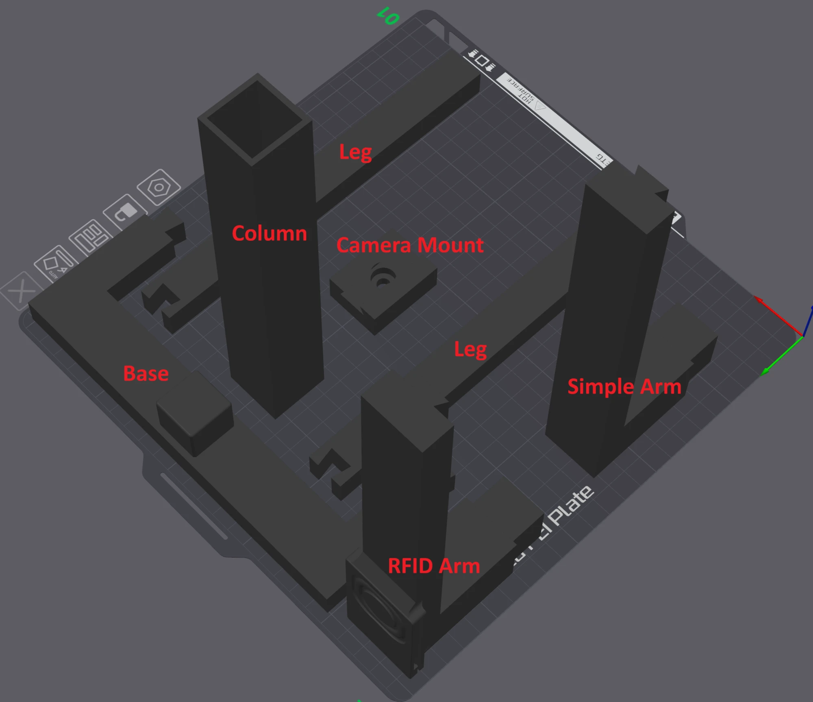

# Station NFC reader guide (Teyleten PN532 V2.0, USB)

The external USB reader for the station is the Teyleten PN532 V2.0. It is a bought part with no kit firmware: it has a
mini USB socket and an on-board CH340E, so it plugs straight into the station computer and needs no adapter or
wiring. The station talks to it with nfcpy. The checked data is in [catalogue.xml](catalogue.xml), and the parts to
buy, with Amazon listing links, are in [bom.md](bom.md). The station's behaviour is in the kit's user guide, in the
station hardware section.

It is used alongside or instead of the station controller's internal reader, which is the PN532 on the intake
panel's I2C bus (U7 on header J7, see the [intake panel guide](../intake-panel/guide.md)). Both may be connected at
the same time; the station counts the same tag from either reader within 2 s as one tap.

## Parts

| Ref | Part | Qty | Use |
|---|---|---|---|
| U1 | Teyleten PN532 V2.0 USB NFC reader, on-board CH340E | 1 | Tag reader and USB link to the station computer |

The datasheet limits of U1 are UNCONFIRMED in [catalogue.xml](catalogue.xml): no source was read for them. It is
bus-powered from the station computer's USB 5 V.

## Setup

1. Plug the board's mini USB socket into a USB port on the station computer.
2. The listing names I2C, SPI and HSU as interfaces. The USB link uses the board's serial (HSU) path, so check the
   board's silkscreen for any mode switch and set it for HSU, with the board unplugged.

## Mounting

The reader mounts in a slot on top of the Intake Station Camera Stand, on the RFID Arm. The Simple Arm is the same arm
without the reader slot. The stand's parts are the Base, Column, two Legs, Camera Mount, Simple Arm and RFID Arm.

## Checks

- `lsusb` shows vendor `1a86`, and a `ttyUSB` port appears.
- The station log says "NFC reader open".
- One tag tap starts one intake, and the tag id matches the one in Spoolman.
- With the intake panel's reader also connected, a tap seen by both readers within 2 s is still one intake.
- After a restart of the station service, the reader opens again without being unplugged.
- Supply current measured and recorded (UNCONFIRMED until measured).

## How the station finds it

The station opens the first `ttyUSB` port that the intake panel isn't on (`nfc_path` in the kit's
`server/filament_kit/station/nfc.py`). It does not check the USB vendor. With the Teyleten board that port is the on-board CH340E's (vendor `1a86`), but
any other `ttyUSB` adapter would be taken the same way. The panel is an ESP32-C3 on a native USB port, so it doesn't appear as a `ttyUSB` port. To pin a port, set
`NFC_DEVICE` to an nfcpy path such as `tty:USB0:pn532`.

## Baud rate and the 921600 wedge

The PN532 keeps its UART speed until it loses power. nfcpy opens it at 115200, moves it to 921600 baud, and sets it
back to 115200 when it closes. If the station stops without that close, the reader stays at 921600 and every later
open at 115200 times out (Errno 110). The station now closes nfcpy first when it is stopped, and if an open fails with a timeout (`ETIMEDOUT`) or a missing device (`ENODEV`) it
tries 921600, 460800, 230400 and 115200 to set the chip back (`pn532_unwedge` in the kit's `server/filament_kit/station/nfc.py`). Any
other open error is only logged and retried after 5 seconds. If a reader still won't open, unplug and replug the
adapter, which cuts the board's power.

## Bench results

| Date | Result | Measured mA | Notes |
|---|---|---|---|
| | | | |

## Alternative: a PN532 V3 in HSU mode on a separate adapter

Any PN532 board in HSU mode on a CH340 or PL2303 USB serial adapter works, because the station takes any `ttyUSB`
port that isn't the panel's. Parts: the board, an adapter with 3.3 V logic, and four female to female jumper wires
(see [bom.md](bom.md)).

The board picks its interface from two switches, usually labelled SEL0 and SEL1 or I0 and I1. For HSU set both OFF
(0). This is the setting on common boards, but it is UNCONFIRMED for yours: check the table printed on its
silkscreen, and set the switches with the board unpowered. On an Elechouse NFC Module V3 the back of its 4-pin
header is labelled GND VCC TXD RXD: TXD goes to the adapter's RX, and RXD goes to the adapter's TX.

TX and RX cross: the adapter's TX goes to the board's RX, and the adapter's RX goes to the board's TX.

| Adapter | PN532 board |
|---|---|
| GND | GND |
| 5V or 3V3 (the supply the board's label asks for) | VCC |
| TX | RX |
| RX | TX |

Use the adapter's 3.3 V logic setting if it has a jumper for it. If the reader never opens, swap TX and RX first. A
CH340 adapter shows as vendor `1a86`; a PL2303 cable shows as `067b`, which the station also accepts.
